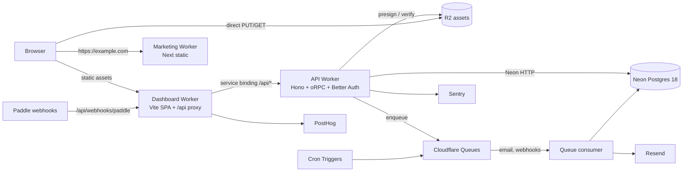

# 00 — Decision: the stack to build the creator SaaS

Synthesized 2026-11-28 from `01-frontend.md` … `06-ai-tooling.md`, with conflicts resolved
against live sources. Hard constraint: **$0 upfront, no subscription**; a credit card is available
for billing verification and free-tier usage, but must not be charged. Target free operation to
~10k users, with the real managed-tier ceiling and the $0 escape hatch stated in §4.
Owner: one developer supervising AI agents.

## 1. The stack

| Layer | Choice | Version | Why it wins here | $0 ceiling |
| --- | --- | --- | --- | --- |
| Marketing site | Existing Next.js static build, unchanged | 16.4.6 | Already green, 44 static routes, zero request CPU | Unlimited static assets |
| Dashboard app | **Vite + React 19 + React Router SPA** | React 19.3.1 | Next static export cannot do dynamic routes and Workers Free cannot SSR; a dashboard needs neither SEO nor RSC | Static assets are free |
| Components | **Astryx** `core` + `theme-neutral` + local `tano` theme | 0.7.17 (exact) | 150+ accessible components incl. Table, Command Palette, Toast, Rich Text, File Input; CSS-variable themes; MIT | Free forever |
| Dashboard CSS | **Plain CSS in one `@layer dashboard`** | — | Astryx owns components/tokens; bespoke CSS is layout only. No Tailwind, no CSS Modules (unlayered) | Free |
| Client state | **TanStack Query** | 5.108.4 | Cache, invalidation, retries; RSC is not in play | Free |
| Forms | **React Hook Form + Zod** | 7.92.0 / 4.6.7 | One schema on client and API; highest AI corpus | Free |
| URL state | **nuqs** (or React Router search params) | 2.10.3 | Typed filters/tabs/pagination | Free |
| Charts | **Recharts** | 3.11.2 | Astryx charts are canary-only (`0.0.0-bootstrap.0`); Recharts is the mature React 19 option | Free |
| Board DnD | **dnd-kit** | 6.3.1 | Keyboard-accessible deliverable pipeline | Free |
| API | **TypeScript + Hono + oRPC** on Cloudflare Workers | Hono 4.13, oRPC 1.16 | One type graph across three apps; contract-first OpenAPI; native Workers | 100k req/day, 10 ms CPU |
| Database | **Neon Free Postgres 18** via `@neondatabase/serverless` HTTP + **Drizzle** | Drizzle 0.45.4 | Postgres semantics, native `uuidv7()`, no card, no TCP/`nodejs_compat` for domain queries | 1 GB, 100 CU-h, **5 GB egress/project** |
| Auth | **Better Auth** self-hosted, org + admin + passkey + email-OTP plugins | 1.7.28 | Orgs, invitations, roles, impersonation, session revocation in our DB; MIT | Free forever |
| Files | **Cloudflare R2** (previews only) | Free allowance | Zero egress; presigned direct uploads; derivatives generated client-side, not via Cloudflare Images | 10 GB; card on file, $0 usage |
| Jobs | **Cloudflare Queues + Workflows + Cron** | — | Native, retries/DLQ, free at MVP volume | 10k ops/day; 3k steps/day |
| Email | **Resend + React Email** | 6.x | Best DX, 3k/mo free | 3k/mo, 100/day |
| Errors/logs | **Sentry Education + Workers Logs + PostHog** | Student | Errors, request logs, product analytics/flags in three tools | 50k errors while student; 5k fallback; 1M events |
| Billing | **Deferred**; Paddle when revenue exists | 5% + 50¢ | Stripe India is invite-only; Paddle is MoR and supports India | Transaction-only |
| Monorepo | **Bun workspaces** | Bun 1.4.4 | Already the lockfile; no Turborepo until >5 deployables | Free |
| Agent tooling | Astryx CLI, Playwright CLI skills, GitHub MCP, postgres-mcp, Context7 | — | See §9 | Free |

**Total recurring cost at launch: $0.** Only per-transaction fees exist once money moves, plus a
domain (~$10/year). The managed free stack holds to ~1–2k MAU; §4 states the exact walls and the
Oracle migration that keeps the bill at $0 beyond them.

## 2. Architecture



- **Dashboard** is a static SPA. Entity ids travel in path params (`/campaigns/:id`) because React
  Router owns routing; no Next export constraint applies.
- **Same-origin API** through a Worker service binding: cookies are host-only on the app domain,
  no CORS, no third-party cookie problems.
- **Marketing stays Next** on its existing Worker. It shares nothing at runtime with the dashboard.
- **Client and admin dashboards** are route groups in the same SPA against the same API. Role
  decides the landing route; the API decides what data exists.

## 3. Decisions and rejected alternatives

| Decision | Chosen | Rejected | Reason |
| --- | --- | --- | --- |
| Database | Neon Postgres | **D1**, Supabase, Turso, Nile, self-host | D1 is SQLite with 100k row writes/day and a single-threaded DO per DB; our approvals/audit/metrics writes and relational joins fit Postgres. If raw free traffic mattered more than relational correctness, D1 would go further, but it costs a Postgres migration later. Supabase Free pauses after 7 days and has no backups. Turso is mid-acquisition (Supabase, 2026-10-02). See `02-data.md`. |
| Auth | Better Auth | **Clerk**, Auth.js, Supabase Auth, WorkOS | Clerk Hobby caps **100 monthly retained orgs** — a creator/client marketplace passes that before 10k users. Better Auth owns the org/membership model in Neon, has admin impersonation, passkeys, and no per-MAU fee. Auth.js is now Better Auth's predecessor. See `05-services.md`. |
| Passwords | Passkeys + Google OAuth + email OTP; **no password login on Free** | Email+password | Better Auth's scrypt hash exceeds the 10 ms Worker CPU cap. Passkeys verify with WebCrypto (cheap); magic links/OTP are HMAC. Password login returns after Workers Paid. |
| Backend language | TypeScript | Go, Rust, Python | Shared contracts/types, native Workers, best agent tooling. Go is the best server language but needs a second host and loses types; Rust's compile loop is wrong for AI iteration; Python cannot run on Workers. Weighted score 86/100 vs 63/67/47. See `03-backend.md`. |
| Rendering | Vite SPA | Next SSR; Next static + query params | SSR is 10–20 ms CPU vs a 10 ms cap. Next static export forbids dynamic routes without `generateStaticParams` and forbids cookies. Query-param routes work but produce weak URLs; kept as the "one toolchain" fallback. |
| Styling | Astryx + plain CSS layer | Tailwind v4, CSS Modules, second component kit | Astryx already ships tokens, density, motion and 150+ components. CSS Modules are emitted unlayered and silently override Astryx. Tailwind adds a build plugin and duplicates layout primitives; documented fallback only. |
| Charts | Recharts | Astryx charts/vega, visx, ECharts | Astryx charts are not published (`latest` is a bootstrap placeholder). Recharts is the mature React 19 default; swap to ECharts only for >10k points. |
| API contract | oRPC + OpenAPI | tRPC, Hono RPC, GraphQL, OpenAPI-first | oRPC contracts are explicit and reviewable; tRPC's OpenAPI is alpha and needs a TS beta. OpenAPI snapshot in CI. |
| Background jobs | Queues + Workflows | Trigger.dev, Inngest, BullMQ, pg-boss | Native, free at MVP volume, no second runtime. Trigger.dev/Inngest are the fallback when video transcode or >3k steps/day arrives. |
| Redis | None at MVP | Upstash by default | Sessions, rate limits, idempotency and cache keys fit Postgres/KV. Add Upstash only for strict multi-region edge limits. |
| Billing | Paddle, deferred | **Stripe India**, Polar, Lemon Squeezy | Stripe is invite-only in India; Polar cannot pay out to India; Lemon Squeezy is closing. Paddle supports India and is MoR (handles tax). Do not integrate until a paying client exists. |
| Email | Resend | Postmark, SES, Cloudflare Email | 3k/mo, no card, React Email. SES is the cheap escape hatch later (card + expiring credits). |
| Monorepo | Bun workspaces | Turborepo, Nx, pnpm | Bun is already present and Workers Builds preinstalls it. Add Turborepo only when CI >10 min or >5 deployables. |

## 4. The $0 math — and where it actually breaks

| Budget | Free limit | What it really buys | Mitigation |
| --- | --- | --- | --- |
| Workers requests | 100k/day | 8 dynamic requests/MAU/day = 80k/day at 10k. Static assets free | TanStack Query `staleTime`, no polling, batch endpoints, cache public data |
| Workers CPU | 10 ms/invocation | CRUD/auth/passkey verify fit; SSR and scrypt do not | SPA + API only; no server rendering; no password hashing on Free |
| **Neon egress** | **5 GB/project/month**, shared by Postgres + Object Storage + Functions; compute suspends when exhausted | 5 GB ≈ 166 MB/day. At 10k MAU and 8 queries/day that is **~2 KB per response** — a campaign list already exceeds it. This is the first hard wall, around **1–2k MAU** `[INFERENCE]` | Select narrow columns, paginate, aggregate in SQL, cache in the SPA; at ~1k MAU move Postgres to Oracle (below) or accept Neon Launch (~$15/mo) |
| Neon compute | 100 CU-h/project/month | 0.25 CU × ~400 h ≈ 12 h/day active; autoscaling burns faster | Scale-to-zero, single region, short queries, no long reports |
| Neon storage | 1 GB | Metrics dominate; storage alone would reach ~2–3k active creators with 90-day metrics `[INFERENCE]`, but egress binds first | 90-day hot metrics, monthly rollups, Parquet archive, text/JSON discipline |
| R2 storage | 10 GB | **Preview-only** budget. At ≤2 MB/asset and ≤50 MB/org that is ~200 orgs, ~160 once backups take ~2 GB; raw media for 10k creators is impossible | Store compressed previews/thumbnails, not originals; video by link; MinIO on a free VM only if media is the product |
| Cloudflare Images | 5k unique transforms/month | ~1,666 assets at 3 sizes — not a 10k-user path | Generate derivatives client-side or in a Worker and store them in R2; do not depend on Images |
| Email | 3k/mo, **100/day hard** | New-user invites alone can exceed 100/day during growth. Realistic ceiling **~1.5k MAU**, not 10k | Passkey/OAuth primary; in-app invite links; email only reset/invoice; SES or Resend Pro before growth |
| Queue ops | 10k/day (~3.3k messages) | One message per campaign per day → ~3.3k campaigns/day; per-channel fan-out blows it | One message per campaign/org per day, or a GitHub Actions batch |
| Workflow steps | 3k/day | Plenty for dunning/reminders | No per-user workflow |
| Error quota | 50k/mo with Sentry Education (5k fallback) | 5 errors/MAU/month at 10k would fill the student quota | Sample, fingerprint, filter noise; don't run Datadog and Sentry together |

**Honest verdict.** The managed stack is $0 comfortably to **~1–2k MAU**, and the binding limit is
Neon's 5 GB/month egress, not Workers or storage. **$0 at 10k users is not achievable on Neon Free.**
The only way to keep both Postgres and a $0 bill is to move the database to an **Oracle Always Free
ARM VM** (Ampere A1; ~2 OCPU/12 GB continuous within 1,500 OCPU-h/9,000 GB-h monthly, 200 GB block,
card verification, no charge) running Postgres and MinIO behind Cloudflare, with the API either on
Workers or on the same VM. That trades money for ops, has no SLA, and Oracle can reclaim an instance
whose 95th-percentile CPU/network/memory stay below 20% for 7 days — a health check does not prevent
that; only real traffic or an upgrade does. Plan the migration at ~1k MAU, not at 10k.

**What is impossible for $0 at 10k users:** raw video storage/transcode, unlimited asset history,
Neon-scale egress, and unlimited transactional email. Design the product around links, previews and
in-app notifications rather than pretending those budgets do not exist.

## 5. Design continuity — Tano language in a productivity UI

Astryx is the component/token authority; Tano is an **input** to a local `tano` theme, never a
stylesheet the dashboard loads. The marketing CSS (370 KB of `.wire-*`/`.hp-*` rules, `html`
veils, Lenis) must not ship on `/app`.

> **Commercial-launch gate (applies to marketing too).** This repo is a Tano reference rebuild:
> its logo, copy, photography, films and ABC Whyte font are Tano Limited's property. Keeping the
> marketing app “unchanged” is fine for development, but a public paid launch must replace those
> assets and the font on `www` as well — not only in `/app`. Until that rebrand lands, keep the
> marketing deployment `noindex`/private. Do not ship the clone as your company's site.

| Carry from Tano | Astryx target | Rule |
| --- | --- | --- |
| `--page-primary`, `--surface-primary-default`, `--page-secondary` | `--color-background-body/card/surface` | Ground and panels |
| `--text-primary/secondary`, `--border-primary/strong` | `--color-text-*`, `--color-border*` | Contrast checked per mode |
| `--tano-button-radius` 12/16/24 px | `--radius-element/container/page` | `--radius-inner` 8 px |
| `--typeface-*` | `typography.heading/body` | **ABC Whyte is commercially licensed; ship Figtree (OFL)**. Never import `public/sites/tano/fonts` into the app |
| `--spectrum-*` / `--chart-*` | `--color-data-categorical-*` | Charts and small accents, never body text |
| `--ease`, `--ground-ms: .6s`, `--ink-ms: .15s` | `motion: {tempo: 0.85, character: 'crisp'}`, `--ease-entrance/move` | Theme switch cross-fade only; no scroll reveals, no spectrum drift, no Lenis |

Component mapping: `AppShell`/`SideNav`/`TopNav` for chrome; `Table` (sorting, selection,
pagination, column settings, row virtualization) for deliverables/campaigns; `CommandPalette`
for navigation; `Toast` for mutations; `FileInput` + presigned R2 for uploads; `RichTextEditor`
(Lexical) for briefs/notes; `DateRangeInput` for reporting. Recharts consumes the categorical
tokens. This is the whole of the "same style" requirement without a second design system.

The detailed theme snippet, layers and exact CSS order are in `01-frontend.md` §2–§4 for the Vite
entry (`index.html` → `main.tsx` → `App.tsx`).

## 6. Data model and multi-tenancy

One database, three surfaces. `orgs` (`kind: creator|client`) + `memberships` are the only source
of authority; every tenant table carries `org_id NOT NULL`; every index on a tenant table starts
with `org_id`. Cross-tenant visibility exists only through `campaigns.client_org_id`, and that
single path gets its own denial test.

Core tables (see `02-data.md` for the ER diagram and DDL): `users`, `orgs`, `memberships`,
`invitation`, `session`, `account`, `verification`, `passkey`, `rate_limit` (the auth tables are
Better Auth-generated; do not hand-write a partial set), `brands`, `campaigns`, `deliverables`,
`deliverable_versions`, `approvals`, `comments`, `metrics_daily`, `invoices`, `payouts`,
`messages`, `notifications`, `audit_log`, `processed_events`.

**Roles.** One 8-role org enum — `owner`, `admin`, `producer`, `editor`, `finance`,
`client_admin`, `client_reviewer`, `client_viewer` — declared once with Better Auth
`createAccessControl` and reused by `policy.ts`. `platform_admin` is not an org role: it is
`users.platform_role = 'admin'` (or `support`) plus an audited impersonation session. No other
role vocabulary is allowed in route guards, DDL or UI.

Rules that prevent the expensive classes of bug:

- **Authorization is one module.** `packages/auth/src/policy.ts` exports `can(actor, action,
  resource)`; procedures declare a permission; repositories take `orgId` first. Dashboard code
  cannot import `@tano/db` (lint rule), so there is no second query path.
- **No RLS at v1.** The API is the only DB client; RLS would duplicate authz and the HTTP driver
  has no session for `SET LOCAL`. The schema is RLS-ready: enable it when a second DB client
  (Metabase, an LLM SQL tool, a data API) appears.
- **Money is `bigint` minor units + `char(3)` currency**, never float. Invoices/payouts are never
  deleted; they are voided/superseded. Approvals use `version` + `decision='pending'` in the
  `UPDATE` and return 409 on a lost race.
- **Auth tables are Better Auth's.** Map `organization → orgs`, `member → memberships`, and let it
  own `invitation`, `passkey`, `rate_limit`, `session`, `account`, `verification`. Generate them with
  the CLI for the exact plugin set; a hand-written subset fails at the first auth request.
- **Audit is append-only and atomic with the mutation.** On Neon HTTP, write the change and the
  audit row in one CTE (`WITH upd AS (UPDATE … RETURNING …) INSERT INTO audit_log … SELECT … FROM
  upd`) or one `db.batch`; never rely on two independent statements. If a flow cannot be expressed
  that way, use an outbox row in the same statement and reconcile. Audit: role change, invite,
  impersonation, approval, invoice, payout, asset delete.
- **Deleting an org does not delete financial history.** Keep the org row as a tombstone, anonymize
  PII, and keep invoices/payouts/audit rows with `on delete restrict` (8 years per Indian company
  and GST law, CA-reviewed). The FK must not cascade-delete them. Legal retention wins over
  “delete my account”.
- **Creator payouts need KYC fields before the first rupee moves.** `orgs` carries `legal_name`,
  `pan`, `gstin`, `tax_residency`, `payout_method`; `payouts` carries gross, platform fee, TDS, net,
  provider, provider ref, status, paid_at. TDS/GST handling is manual and CA-reviewed at launch.
- **Analytics stays in Postgres** as daily rollups; PostHog is for product events, not invoiceable
  numbers. Move to ClickHouse only past ~20M hot rows or >2 GB.

## 7. Backend, contracts, and repo shape

```
tano-clone/                 # root = marketing app, unchanged
  apps/dashboard/           # Vite + React Router + Astryx
  apps/api/                 # Hono + oRPC + Better Auth Worker
  packages/contracts/       # oRPC contracts + Zod schemas (browser-safe)
  packages/db/              # Drizzle schema, migrations, repositories
  packages/auth/            # Better Auth factory, actor resolver, policy
  packages/theme/           # @tano/theme: Tano tokens + Astryx tano theme
  packages/ui/              # @tano/ui: Astryx wrappers + dashboard primitives
  packages/config/          # tsconfig, ESLint, env schemas
```

- **oRPC contract-first.** One contract produces the RPC handler, a typed client and an OpenAPI 3.1
  snapshot; CI diffs the snapshot so an agent cannot silently change the public API.
- **Per-request DB client.** Workers forbid I/O across requests. `createDb(env)` returns a Neon
  HTTP Drizzle client per request. Better Auth also uses Neon HTTP (official Cloudflare guide);
  the old `unable_to_create_user` issue was fixed in 1.3.12, and 1.7.28 is current. If a future
  flow needs interactive transactions, use a per-request `neon-serverless` pool as a targeted
  exception and test it — do not introduce a module-scope pool.
- **Auth wiring.** Better Auth at `/api/auth/*`; Google OAuth, passkeys, email OTP; org plugin for
  invitations/roles; admin plugin for audited impersonation. `rateLimit.storage: "database"`,
  `cf-connecting-ip`, `nodejs_compat` (default from compatibility date 2026-08-04). Passkey
  `rpID` is the registrable domain (`example.com`), allowed origin `https://app.example.com`; OAuth
  redirect URI is `https://app.example.com/api/auth/callback/google`.
- **Jobs.** Webhooks/email enqueue; metrics sync runs as a GitHub Actions batch. Queues are at-least-once: claim an event as
  `received → processing` with a lease, run the side effect with the provider's idempotency key,
  then mark `done`. Inserting the id *before* the side effect and returning on retry silently drops
  work; only `done` is terminal. Cron only dispatches; heavy sync runs in GitHub Actions as one
  batch per campaign/day, not one message per channel.
- **Migrations.** `drizzle-kit generate` in PR, `git diff --exit-code drizzle/` in CI, migrate from
  CI against `DATABASE_URL_UNPOOLED`, expand→deploy→contract. Never `drizzle-kit push` in CI.

**Platform plumbing (day one).**

| Concern | Decision |
| --- | --- |
| DNS / domain | One domain from the Student Pack (Namecheap `.me` or `.TECH`), DNS on Cloudflare. `example.com` marketing, `app.example.com` dashboard; API stays private behind the service binding and is exposed only at `/api/*` through the dashboard Worker |
| Secrets | `wrangler secret put` for `DATABASE_URL`, `BETTER_AUTH_SECRET`, Google OAuth pair, `RESEND_API_KEY`, R2 keys, Paddle webhook secret; `.dev.vars` locally; never in `wrangler.jsonc` or the repo |
| Cookies / CORS | Host-only `HttpOnly` `SameSite=Lax` session cookie on `app.`; no CORS because the SPA calls its own origin; Better Auth `trustedOrigins` lists only `https://app.example.com` |
| Rate limits | Better Auth `rateLimit.storage: "database"` plus Cloudflare Rate Limiting rules on `/api/auth/*` and upload presign; per-org quotas enforced in the procedure, not the UI |
| Abuse | Cloudflare Turnstile on signup/OTP, per-email and per-IP send caps, Resend usage alerts at 70/90%; size/MIME allowlist, magic-byte checks, reject SVG/HTML/archives, signed short-lived asset URLs, per-org storage caps |
| Upload CORS | R2 bucket CORS: allowed origin `https://app.example.com`; methods `PUT, GET, HEAD`; allowed headers `content-type`; expose `ETag`; presigned PUT valid 15 minutes |
| Environments | Local Neon branch + `.dev.vars`; PR previews use one Neon branch and `wrangler versions upload`; production migrates only from `main` |
| Backups | Nightly `pg_dump -Fc` → R2, **7 daily + 4 weekly (~2 GB)** plus Neon 6 h PITR; if R2 is not enabled, encrypted dumps as GitHub Actions artifacts (90-day) + a weekly local copy; monthly restore drill into a branch |
| Retention | 90-day hot metrics, monthly rollups, Parquet archive; soft-deleted rows purged after 30 days; invoices/payouts/audit never deleted |

## 8. Build order

| Phase | Deliverable | Acceptance |
| --- | --- | --- |
| 0 | Baseline | `bun run check` + `assert:static` green on the untouched marketing app |
| 1 | Workspace | `apps/`, `packages/`, `packageManager`, catalog; marketing build still green; one lockfile |
| 2 | Data | Neon project, Drizzle schema + first migration, seed, CI drift gate; cross-tenant denial tests |
| 3 | API + auth | Hono/oRPC health, Better Auth passkey + Google + org create/invite, OpenAPI snapshot, sign-up→org→invite e2e |
| 4 | Dashboard shell | Vite app, Astryx `tano` theme, AppShell/nav, `/api` proxy, `RequireRole`, Playwright foundation test (button padding ≠ 0) |
| 5 | Vertical slice | Campaigns list/detail, deliverables, approval with optimistic concurrency; TanStack Query invalidation |
| 6 | Assets | Presigned R2 upload with bucket CORS, checksum/size verification, **client-side derivatives stored in R2 (no Cloudflare Images dependency)**, preview quota 50 MB/org |
| 7 | Client dashboard | Client org invite, approvals, comments, invoices read-only; denial tests |
| 8 | Payouts + KYC | Manual monthly payout run, PAN/GSTIN/tax residency fields, TDS/GST worksheet, creator statement; no automated Connect at $0 |
| 9 | Admin | Org search, audited impersonation, usage/quota view; no standing data access |
| 10 | Ops | Sentry + PostHog + Workers Logs, nightly `pg_dump`→R2, restore drill, retention jobs, quota/egress alerts |

Billing is deliberately absent: manual invoices until a client pays, then Paddle. Video is a link
until a paying client requires hosting.

## 9. AI-agent workflow

Install now (max 12, all free): Astryx CLI + `astryx init --features agents`; Playwright CLI with
`--skills=agents`; GitHub MCP; postgres-mcp (`--access-mode=restricted`); Context7; Chrome DevTools
MCP (`--slim`); Cloudflare MCP; Sentry toolkit after first deploy; Firecrawl keyless; Superpowers
(MIT) for TDD/debug/review discipline. Do not install archived Semgrep MCP, Browserbase, the
archived reference Postgres server, Figma MCP on a 20-call free tier, or 3,000-skill packs.

Write nine repo-local skills in `.agents/skills/`: `next16-app-router` (marketing only),
`astryx-ui`, `drizzle-postgres`, `multi-tenant-authz`, `paddle-webhooks` (`Paddle-Signature`
verification, event ids, state-machine transitions), `playwright-verify`, `design-tokens`,
`content-schema-guard`, `security-diff-review`.
Keep gates authoritative: typecheck, lint, unit, Playwright, Semgrep OSS, OpenAPI diff, protected
paths (`src/styles/`, `src/content/routes.ts`, generated Astryx theme). Copilot code review is
paid-only; do not depend on it. See `06-ai-tooling.md`.

**Student benefits actually used (India):** GitHub Pro + Copilot Student + Codespaces, Sentry
Education (50k errors), New Relic Student (optional), 1Password + Doppler, a Namecheap `.me`
domain, Zed Pro, and Notion Education for solo specs. Do **not** use Figma Education, Linear
Education, JetBrains, Azure, Perplexity Education, or GitHub Pages for the commercial product —
they are non-commercial or ineligible. Details: `07-student-benefits.md`.

## 10. Risks

| Risk | Trigger | Mitigation |
| --- | --- | --- |
| Astryx 0.7 beta churn | minor releases rename targets | Exact pins, monthly upgrade PR, `astryx upgrade --apply`, `astryx doctor`, foundation Playwright test |
| Workers 10 ms CPU | p95 approaches 8 ms or a 1102 appears | SPA + thin API; no SSR, no scrypt; profile with `wrangler tail`; $5 upgrade only at revenue |
| Neon free wall | >5 GB egress, >1 GB, or >100 CU-h | Egress is first: narrow/paginated queries, measure bytes; at ~1k MAU move Postgres to Oracle (same Drizzle schema) or accept Neon Launch |
| Auth edge cases | org create/sign-up fails on HTTP driver | Integration test sign-up→org→invite→accept→impersonate; official Cloudflare guide says HTTP driver; a per-request WS pool is a tested exception only |
| Email quota | >100/day or >3k/mo | Passkey/OAuth primary, in-app invite links, in-app notifications; realistic free ceiling ~1.5k MAU; SES/Resend Pro before growth |
| R2 10 GB | previews + backups exceed 10 GB | Previews-only quota (≤2 MB/asset, ≤50 MB/org, ~160 orgs with backups); no Neon Object Storage fallback (shares the 5 GB egress); Oracle MinIO only if media is the product |
| Payout onboarding | Paddle category/KYC rejection | Apply early, test a live $1 charge/payout; Razorpay India fallback; manual invoices first |
| Payout tax | creators cross TDS/GST thresholds | PAN/GSTIN fields, monthly manual run, CA-reviewed policy, creator statements, provider-agnostic ledger |
| ABC Whyte / Tano IP | marketing or dashboard ships clone assets | Figtree in the app; **replace Tano logo/copy/photography/font on marketing before a paid public launch**, or keep it private/noindex |
| vinext maturity | build breaks on upgrade | Pin vinext; marketing stays static; Docker/Node exit path |
| One free VM (fallback) | idle reclamation / no SLA | Oracle reclaims when p95 CPU/network/memory <20% for 7 days; health checks do not prevent it; accept the risk or pay at this point |

## 11. What would change these decisions

- **10k free users becomes a hard requirement** → move Postgres/MinIO to Oracle Always Free at
  ~1k MAU (the Neon egress wall), or accept the first ~$15–20/month around 1–2k MAU.
- **Astryx ships 1.0 or a stable charts package** → drop Recharts and the pinning ritual; styling
  decision unchanged.
- **Stripe invites the account or an offshore entity exists** → Stripe Connect + Billing replaces
  Paddle/manual payouts.
- **Video becomes a paid feature** → Cloudflare Stream or Mux; Trigger.dev for transcode.
- **A second developer joins** → Turborepo, Storybook/Chromatic, CodeRabbit; not before.
- **Next supports static dynamic routes or Workers raises the free CPU cap** → revisit the Vite
  split; the API/contracts/data model are unaffected.

## 12. Verify before writing code

1. Deploy a throwaway API route and measure p95 CPU with `wrangler tail` on Workers Free.
2. Run Better Auth sign-up → create org → invite → accept on Neon HTTP (no pool).
3. Measure the bytes returned by the first list endpoints; project the Neon 5 GB/month egress
   against 100/1k/10k MAU. This is the number that decides the Oracle migration date.
4. Confirm R2 billing stays at $0 under 10 GB with the card on file; no Neon Object Storage fallback
   (shared egress) — self-host MinIO only if media becomes the product.
5. Confirm Paddle accepts the creator-services category and an Indian sole proprietor before
   promising payouts.
6. Measure Astryx's real CSS payload and the dashboard's first-load JS after the theme is built.
7. Re-check Neon egress/storage/CU-h on the account's usage page at 100 users, not at launch.
8. Before any public launch, confirm the marketing site no longer ships Tano's logo, copy,
   photography or ABC Whyte font.
