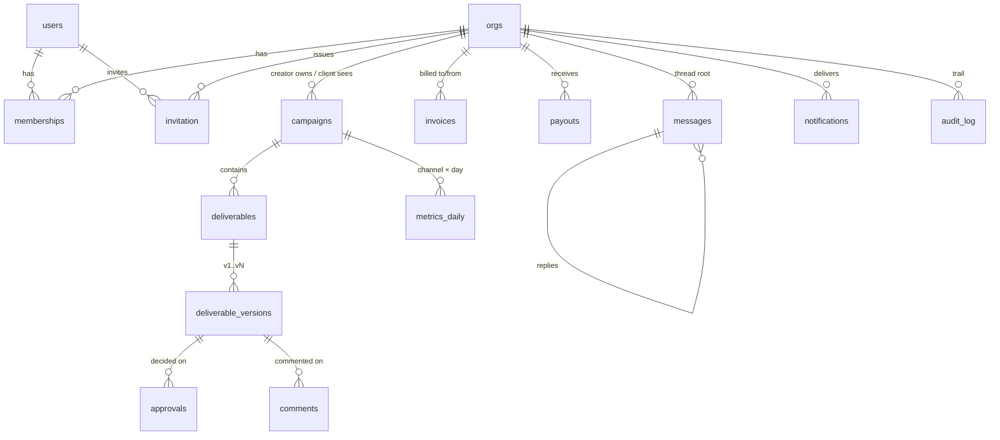

# 02 — Data layer: provider, ORM, tenancy, schema, analytics, ops

Checked **2026-11-28** against live pricing/docs. Budget rule: **$0 upfront, no charge**; a card is available for billing verification and free-tier usage. Paid steps are labelled as
later upgrades; unverified reasoning is marked **[INFERENCE]**.

| Decision | Primary | Fallback | Rejected |
| --- | --- | --- | --- |
| Database | **Neon Free** — Postgres 18, 1 GB, **5 GB/mo egress**, 100 CU-h/project, 6 h PITR, 10 branches | Supabase Free — 500 MB, bundled auth/storage, **no backups** | D1, Turso, Nile, self-host |
| ORM | **Drizzle 0.45.4 + drizzle-kit 0.31.11** (exact pins) | Prisma **7.10.1** pinned | Prisma 8 RC, Drizzle 1.0 RC |
| Tenancy | **One DB, `org_id` everywhere, app-enforced authz** | — | schema-per-tenant, RLS-first |
| Analytics | **Postgres `metrics_daily`** + PostHog Free (product) | ClickHouse Cloud at the trigger in §5 | Tinybird Free, D1 |
| Assets | **R2** (10 GB, $0 egress) | Previews-only (no originals) or MinIO on the Oracle Always Free ARM VM | S3 trial |
| Search | **Postgres FTS + `pg_trgm`** | Meilisearch self-hosted | Typesense Cloud, Meilisearch Cloud |

## 1. Provider comparison (live limits, 2026-11-28)

| | **Neon Free** | **Supabase Free** | **Turso Free** | **Nile Free** | **D1 (Workers Free)** | **Self-host** |
| --- | --- | --- | --- | --- | --- | --- |
| Engine | Postgres 18 (default) | Postgres 17 [INFERENCE] | SQLite/libSQL | Postgres, tenant-virtualised | SQLite (D1) | Postgres 18 |
| Storage | **1 GB/project** | **500 MB** | 5 GB | 1 GB | **500 MB/db**, 5 GB acct | VM disk |
| Egress | **5 GB/project/mo** of public network transfer, shared by Postgres + Object Storage + Functions; **compute suspends** when exhausted | 5 GB/mo | not published | not published | none (D1 is internal to Cloudflare) | VM NIC |
| Compute | 100 CU-h/project, 0.25 CU, scales to zero after 5 min | Shared CPU, 500 MB RAM | n/a | 50 M query tokens | 5 M reads/day, **100 k writes/day** | VM |
| Other | 100 projects, 10 branches, 1 snapshot, 5 GB object storage (counts against egress) | **2 projects**, 5 GB egress, 1 GB files, 50 k MAU | 100 DBs, 500 M reads/mo, 10 M writes/mo, 1-day PITR | unlimited DBs/tenants | 10 DBs | — |
| Card | **No** | No | No | No | No | Azure $100 credit |
| Idle | Scale to zero, no CU charge | **Paused after 1 week idle** | Always-on | Unknown | Scale-to-zero | Always-on |
| PITR | **6 h / 1 GB changes** + 1 snapshot | **None** (Pro+ only) | 1 day | Unknown | Time Travel | none |
| Pooling | PgBouncer, 10 k pooled | Supavisor 60 direct / 200 pooled | HTTP | HTTP | binding | manual |
| **Stops being free at** | **>1 GB, >5 GB egress/mo, >100 CU-h/mo (~400 h at 0.25 CU), >10 branches, PITR >6 h** | **>500 MB, >5 GB egress, >1 GB files, 3rd project, 7 days zero traffic** | >5 GB or >500 M reads/mo | >1 GB or >50 M tokens | **>500 MB, >100 k writes/day** | credit expiry |
| First paid step | **~1–2 k MAU** → Launch, ~$15/mo typical | Pro $25/mo | $4.99/mo | $15/mo | $5/mo | VM + ops |
| Source | [neon.com/pricing](https://neon.com/pricing) | [supabase.com/pricing](https://supabase.com/pricing) | [turso.tech/pricing](https://turso.tech/pricing) | [thenile.dev/pricing](https://www.thenile.dev/pricing) | [D1 pricing](https://developers.cloudflare.com/d1/platform/pricing/) · [limits](https://developers.cloudflare.com/d1/platform/limits/) | — |

**D1 rejected:** 500 MB/db free, a 100 k rows/day write cap (audit logging plus `metrics_daily` upserts blow it in an
afternoon), and each database is a **single-threaded** Durable Object. **Turso rejected:** SQLite, no real RLS, and Supabase
acquired it on 2026-10-02 ([announcement](https://turso.tech/blog/turso-is-joining-supabase)) — needless risk for a ledger.
**Nile rejected for v1:** 1,088 stars ([repo](https://github.com/niledatabase/niledatabase)), Apache-2.0, interesting tenant
virtualisation, but it pulls auth onto Nile's model for the same 1 GB. **Self-host rejected:** the DigitalOcean $200 student
credit was retired **2026-08-01** ([reported](https://github.com/orgs/community/discussions/200663)); Azure for Students ($100/12 mo)
[INFERENCE] buys one small VM with no PITR, no branching, no backups — useful later to host Meilisearch/ClickHouse, never the
system of record.

**Neon egress is the real MAU ceiling, not storage.** Neon Free meters **5 GB/project/month of public network transfer**, and
Postgres, Object Storage and Functions all draw on the same 5 GB; when it is exhausted, **compute suspends** until the next
cycle ([neon.com/pricing](https://neon.com/pricing), [limits](https://neon.com/docs/introduction/limits)). 10 k MAU does not
fit in that budget with normal JSON APIs: 10,000 users × 20 sessions/month × 25 KB of responses is already ~5 GB of response
bytes alone, before Postgres wire overhead, auth round-trips and any object download [INFERENCE]. Treat egress as a product
constraint: select only rendered columns, page every list (keyset, `limit ≤ 50`), compress JSON, never poll (`staleTime ≥
60 s`), and record per-route response bytes in the Phase-3 load test. The honest Neon Free ceiling is therefore **~1–2 k
MAU**, not 10 k; the first paid step arrives at that ceiling, not at 1 GB of storage.

### 1.1 Workers connectivity — what actually works in vinext

Workers Free: **100 k requests/day, 10 ms CPU/invocation, 50 subrequests/request, 6 simultaneous connections** — an in-flight
`fetch()` counts as one of the six until response headers arrive
([limits](https://developers.cloudflare.com/workers/platform/limits/)).

| Path | Works in vinext? | Free cost | Verdict |
| --- | --- | --- | --- |
| **Neon serverless driver, HTTP** (`@neondatabase/serverless`) | Yes — `fetch`, no `nodejs_compat`, no TCP; each query is one subrequest | $0 (Neon CU-h + Workers req/day) | **Use for all reads and single-statement writes** |
| Neon over WebSockets (`Pool`) | Yes, needs `nodejs_compat`; interactive transactions | $0 | Only a proven multi-step flow that no CTE or batch can express, per request and tested |
| **Hyperdrive** | Yes, `pg` + `nodejs_compat`, edge pooling/cache | **100 k queries/day**, then Workers Paid | **No for v1:** a dashboard page costs 3–8 queries, so it dies at ~12–33 k page views/day *before* the request cap |
| Supabase pooler (Supavisor, 6543, transaction) | Yes with `postgres.js` + `nodejs_compat`; `prepare:false`, pool `max:1–5`, IPv4 endpoint | $0 | Works, but adds TCP + Node compat to a stack that needs neither |
| Supabase Data API (PostgREST) | Yes (`fetch`) | $0 | Not reachable through Drizzle; escape hatch only |

**Better Auth 1.7.28 rides the same path:** it uses the Neon HTTP driver — the module-scope-pool bug (issue #4747) was fixed in
1.3.12 — so no module-scope pool belongs in the Worker; a per-request WebSocket pool stays a tested exception only.

**HTTP driver first** — for narrower but still sufficient reasons: no TCP, no `nodejs_compat`, no Hyperdrive 100 k/day
ceiling. It buys no exemption from the 6-connection limit: that cap counts every in-flight `fetch()`, including each Neon HTTP
query awaiting response headers, so seven parallel queries wait for a slot exactly as they would over TCP. Keep per-request DB
concurrency ≤6 — a bounded `Promise.all`, or one query with joins instead of N round trips. HTTP still gives up `SET LOCAL`
and interactive transactions (why RLS is not the default, §3.1). **10 ms CPU is the real $0 risk, not the database:** a
request that makes 4–6 sequential queries plausibly spends 15–40 ms CPU [INFERENCE]; measure the first dynamic route with
`wrangler tail`, and if p95 >10 ms the options are lighter pages or Workers Paid ($5/mo) — the only limit here that can
invalidate the free plan.

## 2. ORM: Drizzle, pinned

| | Drizzle | Prisma |
| --- | --- | --- |
| Repo, stars @2026-11-28 | [drizzle-team/drizzle-orm](https://github.com/drizzle-team/drizzle-orm) **36,431**, Apache-2.0 | [prisma/orm](https://github.com/prisma/orm) **47,748**, Apache-2.0 |
| Stable (npm `latest`) | **0.45.4** (2026-10-08); kit **0.31.11** (2026-09-21) | **7.10.1** (2026-10-15) |
| Pre-release | 1.0.0-rc.6 (2026-11-20); v1.0 still open on the roadmap | **8.0.0-rc.36 (2026-11-26) — and it owns the `latest` tag** |
| Types | inferred from `schema.ts`, one source of truth | generated client from PSL / v8 JSON contract |
| Workers | `drizzle-orm/neon-http` (no flags), `drizzle-orm/d1`, `pg` + Hyperdrive | `@prisma/adapter-neon` / `-d1` (v7); v8 `pg` + `nodejs_compat` |
| Migrations | `drizzle-kit generate` → reviewable SQL | `prisma migrate`, needs a shadow DB |

**Decision: Drizzle 0.45.4 + drizzle-kit 0.31.11, exact pins.** (1) No codegen hop: the agent edits `src/db/schema.ts` and the
compiler points at the break. (2) `npm i prisma` today resolves **8.0.0-rc.36**, whose `contract.prisma` /
`@prisma/orm-postgres` syntax differs from every Prisma example in the training data — pinning 7.10.1 avoids that, but the
ecosystem is mid-migration [INFERENCE]. (3) The Neon HTTP driver needs no flags, TCP or pool. (4) Migrations are plain SQL a
reviewer can read. Cost: Drizzle is pre-1.0, and 1.0.0-rc.6 changes relations/imports — exact pins, no `^`, upgrade as a
scheduled task. Prisma stays the fallback, pinned **7.10.1**, never `latest`.

```bash
npm i drizzle-orm@0.45.4 @neondatabase/serverless
npm i -D drizzle-kit@0.31.11 tsx
npx drizzle-kit generate   # → drizzle/0007_x.sql + journal
npx drizzle-kit check      # collision check, no DB needed
npx drizzle-kit migrate    # applies DATABASE_URL_UNPOOLED (migrations only)
```

**Env names, exactly two.** `DATABASE_URL` is the runtime URL — the Neon pooled/HTTP endpoint the Worker reads per request;
`DATABASE_URL_UNPOOLED` is the direct endpoint, used only by `drizzle-kit migrate` from CI. No third name exists for a direct
connection: code, `.dev.vars`, `wrangler secret` lists and docs use only these two.

```yaml
# .github/workflows/db.yml
- run: npm ci
- run: npx drizzle-kit generate
- run: git diff --exit-code -- drizzle/   # schema.ts changed with no migration → fail
- run: npx drizzle-kit check
- if: github.ref == 'refs/heads/main'
  run: npx drizzle-kit migrate            # DATABASE_URL_UNPOOLED, Node 24 job — never from the Worker
```

**Expand → deploy → contract:** add nullable columns and backfill first, drop/rename in a later PR; Workers deploy in seconds
while a migration takes minutes, so never couple them. Destructive DDL needs a second approval plus a named restore point
(Neon branch or `pg_dump`). `drizzle-kit push` is **local only** — ban it in CI, staging and production.

## 3. Multi-tenancy and authorization

Three surfaces, one database: **creator org** (owns campaigns), **client org** (brand reviewers, approvers, finance), **platform
admin** (support, impersonation, no standing data access). **Decision: single DB, `org_id uuid not null` on every tenant table,
app-enforced authorization.** Schema-per-tenant means migrations × N and no cross-tenant reporting; DB-per-tenant kills
free-tier math and every invoice/metric join.

| Role | Scope | Can |
| --- | --- | --- |
| `owner` | creator | everything incl. billing, delete org, transfer ownership |
| `admin` | creator | members, campaigns, invoices; no org deletion |
| `producer` | creator | campaigns, deliverables, versions, request approval, message |
| `editor` | creator | upload versions, comment; no approve/invoice/invite |
| `finance` | creator | invoices, payouts; read-only elsewhere |
| `client_admin` | client | invite client teammates, approve/reject, see invoices addressed to client org |
| `client_reviewer` | client | approve/reject assigned deliverables, comment |
| `client_viewer` | client | read-only |
| platform admin | none | audited impersonation + metadata only (`users.platform_role`) |

**Better Auth 1.7.28 owns the auth tables, and they are generated, not authored.** The chosen plugin set —
`organization`, `admin`, `passkey`, `emailOTP` — is declared in `src/server/auth.ts`; `npx @better-auth/cli generate` then
emits `packages/db/src/schema/auth.ts` for exactly that set, and Drizzle generates the migration from it. **Never hand-write a
partial auth schema:** a missing column or index is a runtime sign-in failure, not a type error, and hand-added columns are
lost on the next regenerate. Regenerate and `git diff` on every Better Auth bump, like any other schema change. Aliases:
`user`→`users`, `organization`→`orgs`, `member`→`memberships`, `rateLimit`→`rate_limit`; `session`, `account`,
`verification`, `invitation` and `passkey` keep their generated names (quote camelCase identifiers in raw SQL). Field mapping:
`emailVerified`→`email_verified`, `image`→`avatar_url`, `name`→`display_name`. Custom columns are **`additionalFields`**
in the same config — `user.platform_role`, `member.status`, and the `organization` KYC fields (§4) — so the generator emits
them; never `ALTER TABLE` a generated table by hand.

Generated tables: `user`, `session`, `account`, `verification`, `organization`, `member`, `invitation`, `passkey`, and
`rateLimit` (physical `rate_limit`) — the last one because the decision sets `rateLimit.storage: "database"` (`id`, `key`,
`count`, `last_request`). Domain code reads `users`/`orgs`/`memberships`/`invitation` only;
`session`/`account`/`verification`/`rate_limit`/`passkey` are touched by Better Auth, never by repositories. `passkey` columns: `id`, `name`, `user_id` FK→`users`, `credential_id` (BA `credentialID`,
text, unique), `public_key` (BA `publicKey`, text), `counter` (integer), `device_type` (BA `deviceType`,
`singleDevice|multiDevice`), `backed_up` (BA `backedUp`, boolean — passkey synced to a credential manager), `transports` (text,
comma-separated), `created_at` (BA `createdAt`). Passkeys verify with WebCrypto inside the 10 ms CPU cap, which is why they are
the primary credential.

All checks live in one module, `src/server/authz.ts` (`requireOrgRole`, `requireCampaignAccess`); repositories take `orgId` as
a mandatory first argument. The single cross-tenant read path is `campaigns.client_org_id = membership.org_id` — it gets its
own test. **Invitations are not memberships:** BA's `invitation` row holds `email`, `role`, `status`, `expires_at`,
`inviter_id`, `organization_id`, with a partial unique index on `(organization_id, lower(email)) where status='pending'`;
accepting creates the `memberships` row. `memberships` therefore only ever holds `active|suspended|revoked` and a **non-null
`user_id`**, so a pending invite can never be counted as a member. **Impersonation** is a signed ≤30-minute token
carrying the `audit_log.id` of `impersonation.start`; every request logs `actor_id` + `on_behalf_of`, all dashboards show a
banner, and billing actions are blocked. **Audit is append-only and atomic with the mutation** — role change, invite, impersonation, approval decision, invoice state
change, payout, asset delete, export. Neon HTTP has no interactive transaction, so atomicity means exactly one of two
mechanisms:

1. **One statement, CTE** — the mutation and the audit row are a single round trip:
   ```sql
   with upd as (update memberships set role = $3, updated_at = now()
                 where id = $1 and org_id = $2 returning *),
        aud as (insert into audit_log (org_id, actor_id, action, subject_type, subject_id, meta)
                select $2, $4, 'membership.role_changed', 'membership', upd.id,
                       jsonb_build_object('to', $3)
                  from upd)
   select * from upd;
   ```
   Zero matched rows ⇒ zero audit rows ⇒ the procedure returns 404/409; an orphan audit row is impossible.
2. **One non-interactive batch** — `neon().transaction([update, insert])` (Drizzle `db.batch` on `neon-http`) submits both
   statements in one implicit transaction and commits both or neither before the response is sent.

A flow that can express neither (an external side effect must land first) inserts the mutation plus an `audit_outbox` row in
the same CTE, and a Queue/Cron drainer moves outbox rows into `audit_log` and reconciles counts daily. Never claim
`BEGIN … COMMIT` across requests: HTTP cannot hold a session between statements, and a WebSocket pool is not a licence for
interactive transactions in request handlers either (§1.1).

### 3.1 Why not RLS as the primary control

RLS is correct but the wrong *default* here. (1) **The API is the only DB client** — every query already goes through one
authz helper and one repository layer, so RLS duplicates a control that exists; the bug it guards against (a forgotten
`WHERE org_id`) is better caught by a mandatory `orgId` parameter plus a cross-tenant denial test per table. (2) **The cheap
Workers path cannot set it up:** Neon HTTP has no session, so `SET LOCAL app.org_id` cannot precede the query; RLS forces
every request onto WebSockets + `nodejs_compat`, adding per-isolate pools and TCP failure modes to save a `WHERE`. (3) **It
costs a policy per table and a bug per policy:** 15 tenant tables × 4 policies is a second authorisation system to keep in sync, and
divergence is an incident neither system detects.

**Instead: RLS-ready, not RLS-dependent.** `org_id` is `NOT NULL` on every tenant table, every index on one starts with
`org_id`, and `authz.ts` is the only place that builds a tenant filter. Enable RLS later — a migration, not a remodel — when a
second DB client appears (Metabase, Supabase Studio, a data API, an LLM SQL tool), a client demands defence-in-depth, or SOC 2
asks: `FORCE ROW LEVEL SECURITY`, non-owner role, WebSocket pool.

## 4. Domain schema

**Invariants.** `uuid` PKs, **UUIDv7** (`default uuidv7()` — native on Neon's Postgres 18 default; `uuid@14` `v7()` in app code
where the id is needed pre-insert). `timestamptz` only; `created_at`/`updated_at` on mutable tables, `created_at` only on
immutable ones. Money = `bigint` **minor units** + `char(3)` ISO-4217, never float; `invoices`/`payouts` also carry
`provider text` + `provider_ref text` so Paddle → Razorpay/Stripe is a config change, not a migration. `jsonb` only for unqueried payloads
(`audit_log.meta`, `notifications.payload`) — anything filtered or joined gets a column. **Soft delete only where a user can
undo it** (`campaigns`, `deliverables`, `comments`, `messages`; `orgs` use a tombstone): financial and audit rows are
voided/superseded, never deleted, and the `orgs` row that owns them is never hard-deleted (§6);
every unique constraint on a soft-deletable table is a partial index `where deleted_at is null`. `version integer` optimistic
lock on `approvals`. Natural composite PKs only on fact tables (`metrics_daily`). Clients are `orgs` with `kind='client'`; a
separate `brands` table appears only when one client org runs multiple brands, since campaigns already carry `client_org_id`.



`users`(id, email citext, email_verified, display_name, avatar_url, platform_role `user|support|admin`) · `orgs`(id,
kind `creator|client`, name, slug, currency, legal_name, pan, gstin, tax_residency, payout_method, deleted_at) · `memberships`(id, org_id, user_id NOT NULL, role, status
`active|suspended|revoked`) · `invitation`(id, organization_id, email, role, status, expires_at, inviter_id) · `campaigns`(id, org_id, client_org_id,
name, status, budget_minor, currency, deleted_at) · `deliverables`(id, campaign_id, title, status, current_version, due_at,
deleted_at) · `deliverable_versions`(id, deliverable_id, version_no, asset_key, checksum_sha256) · `approvals`(id,
deliverable_version_id, decision, version, decided_by, decided_at) · `comments`(id, org_id, deliverable_version_id, author_id,
body, deleted_at) · `metrics_daily`(campaign_id, channel, day, impressions, engagements, clicks, conversions, revenue_minor,
currency) · `invoices`(id, org_id, client_org_id, number, total_minor, currency, status, due_on, provider, provider_ref) ·
`payouts`(id, org_id, gross_minor, platform_fee_minor, tds_minor, net_minor, currency, status, provider, provider_ref,
paid_at, created_at) · `messages`(id, org_id, thread_root_id, author_id, body, deleted_at) ·
`notifications`(id, org_id, user_id, kind, payload jsonb, read_at) · `audit_log`(id, org_id, actor_id, on_behalf_of, action,
subject_type, subject_id, meta jsonb, created_at) · `audit_outbox`(id, org_id, actor_id, action, subject_type, subject_id,
meta jsonb, created_at, drained_at).

Better Auth's generated tables (`session`, `account`, `verification`, `passkey`, `rateLimit`; §3) are not repeated here — they
are never queried by domain repositories. `orgs`, `users` and `memberships` are the generated `organization`, `user` and
`member` models with `additionalFields`; the DDL below covers only tables Better Auth does not own.

**KYC and payout identity live on the tenant, not in a side table.** Creator `orgs` carry `legal_name`, `pan`, `gstin`,
`tax_residency` (ISO-3166 alpha-2, default `IN`) and `payout_method` (`bank|upi`, null until onboarding); client orgs keep
`pan`/`gstin` null. These are **`organization.additionalFields`** in the Better Auth config (`users.platform_role` is a
`user.additionalFields` entry), so `@better-auth/cli generate` emits them into `orgs`/`users` — a hand-added column would
vanish on the next regenerate. PAN/GSTIN are PII: masked to the last 4 characters on every surface except the owner's payout
settings, and never written into `audit_log.meta`. **TDS (s.194J professional fees / s.194C contracts) and GST withholding are
computed manually at launch**, entered by `finance` from the CA's computation, and reviewed before the first payout run;
nothing auto-files.

### 4.1 DDL — the hard tables (Better Auth's are generated, these are ours)

```sql
create extension if not exists citext;      -- case-insensitive emails
create extension if not exists pg_trgm;     -- fuzzy names (§5)

-- REFERENCE SHAPE: `memberships` and `invitation` are generated by @better-auth/cli (§3). The SQL
-- below documents the required columns/constraints; the generated schema is the source of truth for
-- columns, and extra indexes/checks are follow-up migrations that a regenerate must not drop.

-- 1) memberships (= Better Auth `member` + additionalField `status`, which is BA-generated too)
create type org_role as enum
  ('owner','admin','producer','editor','finance','client_admin','client_reviewer','client_viewer');

create table memberships (
  id         uuid primary key default uuidv7(),
  org_id     uuid not null references orgs(id) on delete cascade,
  user_id    uuid not null references users(id) on delete cascade,
  role       org_role not null,
  status     text not null default 'active'
               check (status in ('active','suspended','revoked')),
  created_at timestamptz not null default now(),
  updated_at timestamptz not null default now(),
  constraint memberships_org_user_uniq unique (org_id, user_id)   -- BA: one member row per org+user
);
create unique index memberships_active_uniq
  on memberships (org_id, user_id) where status = 'active';

-- 1b) invitation (= Better Auth `invitation`): the only place a pending invite exists
create table invitation (
  id              uuid primary key default uuidv7(),
  organization_id uuid not null references orgs(id) on delete cascade,
  email           citext not null,
  role            org_role not null,
  status          text not null default 'pending'
                    check (status in ('pending','accepted','rejected','canceled','expired')),
  expires_at      timestamptz not null,
  inviter_id      uuid not null references users(id),
  created_at      timestamptz not null default now()
);
create unique index invitation_pending_uniq
  on invitation (organization_id, lower(email)) where status = 'pending';
create index invitation_email_pending_idx on invitation (lower(email)) where status = 'pending';

-- 2) deliverable_versions: immutable, append-only, checksum-deduped
create table deliverable_versions (
  id              uuid primary key default uuidv7(),
  org_id          uuid not null references orgs(id),          -- denormalised for tenant filters
  deliverable_id  uuid not null references deliverables(id) on delete cascade,
  version_no      integer not null check (version_no > 0),
  asset_key       text not null,                              -- R2 key, never a public URL
  mime_type       text not null,
  byte_size       bigint not null check (byte_size >= 0),
  checksum_sha256 bytea not null,
  uploaded_by     uuid not null references users(id),
  notes           text,
  created_at      timestamptz not null default now(),
  constraint dv_no_uniq unique (deliverable_id, version_no),
  constraint dv_sha_uniq unique (deliverable_id, checksum_sha256)
);
-- no updated_at: a correction is a new version; asset removal tombstones the row and audits the key

-- 3) approvals: optimistic concurrency + separation of duties
create table approvals (
  id                     uuid primary key default uuidv7(),
  org_id                 uuid not null references orgs(id),
  deliverable_version_id uuid not null references deliverable_versions(id) on delete cascade,
  requested_by           uuid not null references users(id),
  decided_by             uuid references users(id),
  decision               text not null default 'pending'
                           check (decision in ('pending','approved','changes_requested','cancelled')),
  version                integer not null default 1,
  due_at                 timestamptz,
  decided_at             timestamptz,
  created_at             timestamptz not null default now(),
  updated_at             timestamptz not null default now(),
  constraint approvals_no_self check (decided_by is null or decided_by <> requested_by),
  constraint approvals_shape check (
    (decision = 'pending' and decided_by is null and decided_at is null)
    or (decision <> 'pending' and decided_by is not null and decided_at is not null))
);
create unique index approvals_one_open_uniq
  on approvals (deliverable_version_id) where decision = 'pending';
create index approvals_org_pending_idx on approvals (org_id, due_at) where decision = 'pending';

-- optimistic write: 0 rows ⇒ 409 + current row
update approvals
   set decision = $3, decided_by = $4, decided_at = now(), version = version + 1, updated_at = now()
 where id = $1 and org_id = $2 and version = $5 and decision = 'pending'
returning *;

-- 4) metrics_daily: fact table, natural key, upsert-only
create table metrics_daily (
  org_id        uuid not null references orgs(id),
  campaign_id   uuid not null references campaigns(id) on delete cascade,
  channel       text not null check (channel in ('instagram','tiktok','youtube','x','newsletter','other')),
  day           date not null,
  impressions   bigint not null default 0 check (impressions >= 0),
  engagements   bigint not null default 0 check (engagements >= 0),
  clicks        bigint not null default 0 check (clicks >= 0),
  conversions   integer not null default 0 check (conversions >= 0),
  revenue_minor bigint not null default 0,
  currency      char(3) not null,
  synced_at     timestamptz not null default now(),
  primary key (campaign_id, channel, day)
);
create index metrics_daily_org_day_idx on metrics_daily (org_id, day desc);
-- write path: insert … on conflict (campaign_id, channel, day) do update set … , synced_at = now()

-- 5) invoices: issued by a creator org, addressed to a client org; never deleted, never cascaded
create table invoices (
  id            uuid primary key default uuidv7(),
  org_id        uuid not null references orgs(id) on delete restrict,
  client_org_id uuid not null references orgs(id) on delete restrict,
  number        text not null,
  total_minor   bigint not null check (total_minor >= 0),
  currency      char(3) not null,
  status        text not null default 'draft'
                  check (status in ('draft','sent','paid','void','overdue')),
  due_on        date,
  provider      text not null default 'manual',      -- 'manual' | 'paddle' | 'razorpay'
  provider_ref  text,
  created_at    timestamptz not null default now(),
  updated_at    timestamptz not null default now(),
  constraint invoices_number_uniq unique (org_id, number)
);

-- 6) payouts: full split in minor units; tds_minor comes from the CA's computation
create table payouts (
  id                 uuid primary key default uuidv7(),
  org_id             uuid not null references orgs(id) on delete restrict,
  gross_minor        bigint not null check (gross_minor >= 0),
  platform_fee_minor bigint not null default 0 check (platform_fee_minor >= 0),
  tds_minor          bigint not null default 0 check (tds_minor >= 0),
  net_minor          bigint not null check (net_minor >= 0),
  currency           char(3) not null,
  status             text not null default 'pending'
                       check (status in ('pending','processing','paid','failed','reversed')),
  provider           text not null default 'manual',
  provider_ref       text,
  paid_at            timestamptz,
  created_at         timestamptz not null default now(),
  constraint payouts_split check (net_minor = gross_minor - platform_fee_minor - tds_minor)
);
create index payouts_org_paid_idx on payouts (org_id, paid_at desc);
```

**Deleting an org never deletes money.** `invoices` and `payouts` reference `orgs(id) on delete restrict`, and `audit_log.org_id`
does too where it is set; org deletion is a tombstone + PII scrub (§6), so the financial rows and their FK target survive. A
cascade from `orgs` would erase the tax record the law requires keeping, which is why the org row is never hard-deleted.

## 5. Analytics, assets, search

`metrics_daily` is the **customer-facing** source of truth (it joins campaigns, invoices, orgs); product analytics is a
different question with a different tool.

| Need | Tool | Free limit | Move when |
| --- | --- | --- | --- |
| Campaign/channel performance, invoiceable numbers | **Postgres `metrics_daily`** | in DB | >20 M rows, >2 GB, or p95 >400 ms → archive + ClickHouse |
| Funnels/retention/feature usage (internal) | **PostHog Free** | 1 M events/mo, no card, stops at limit ([pricing](https://posthog.com/pricing)) | >1 M events/mo (usage-based) |
| Customer-facing analytical API | ClickHouse Cloud | no free tier; Tinybird Free = **1 k req/day** — a 10 k-user dashboard needs ~50 k/day, so it is out | only when rollups fail |
| Archive | Parquet in R2 + DuckDB | 10 GB | — |

At 10 k creators: `10,000 × 3 campaigns × 6 channels × 365 ≈ 65 M rows/year` [INFERENCE], far past Neon Free's 1 GB. Keep
**90 days hot**, roll older rows into a monthly aggregate, export raw detail to R2 Parquet. Even 90 days ≈ 16 M rows ≈ 1.5–2.5 GB,
so the storage ceiling is **~2–3 k active creators**, while Neon's 5 GB/mo egress (§1) binds earlier at **~1–2 k MAU**;
build the archive job before 700 MB, not after.

**Assets — R2** (10 GB-mo, 1 M Class A, 10 M Class B, $0 egress). Keys
`org/{org_id}/campaign/{id}/deliverable/{id}/v{n}/{sha}.{ext}`, private bucket, downloads via a Worker that calls `authz.ts`
and returns a 5-minute presigned URL; never store public URLs. R2 wants a card on file in practice ([reports](https://community.cloudflare.com/t/getting-you-are-not-entitled-to-use-r2-code-10042-on-cloudflare-r2-dashboard/401862))
[INFERENCE] — without a card the fallback is **previews only** (no stored originals; the deliverable references the client's
URL) or **MinIO on the Oracle Always Free ARM VM** (the § 00 fallback, trades ops for capacity). Neon Object Storage is *not* a
fallback: its 5 GB shares the project's 5 GB egress (§1) and it has no CDN. Supabase Storage (1 GB) only on Supabase. Never
S3: 5 GB for 12 months, then paid.

**Search — Postgres FTS now:** generated `tsvector` over `campaigns.name/brief`, `deliverables.title`, `comments.body`,
`messages.body`, GIN index, `websearch_to_tsquery`, plus `pg_trgm` for names: no extra service, same `org_id` filter, one
backup story. Move to **Meilisearch self-hosted** (MIT engine free; Cloud $20/mo) above ~100 k documents. Typesense Cloud's
"free" is a **720-hour trial**, not a tier.

## 6. Backups, seeding, test DBs, retention

| Concern | Plan |
| --- | --- |
| Provider PITR | Neon Free: 6 h / 1 GB of changes + 1 snapshot — enough for a bad migration, not for compliance |
| Logical backups | **Nightly `pg_dump -Fc` → R2**, **7 daily + 4 weekly (~2 GB)** so backups do not consume the 10 GB preview allowance; monthly set waits for paid storage. GitHub Actions cron; monthly restore drill into a Neon branch with row-count assertions and a recorded time-to-restore |
| Seeding | `src/db/seed.ts`, fixed RNG, deterministic ids; fixtures `creator-org`, `client-org`, `platform-admin`; never production |
| Tests | **PGlite** for repository tests (fast, no container); **`postgres:18`** in CI for migrations, constraints, the empty-DB + restored-dump migration run, and cross-tenant denial (extension coverage differs) [INFERENCE] |
| Preview DBs | **One** on-demand Neon branch per open PR, deleted on merge — branches share the project's 100 CU-h, so never keep 10 alive |
| Retention | `metrics_daily` 90 d hot → monthly + Parquet; `notifications` 90 d; `messages` 24 mo after `deleted_at` (dispute window; a legal hold wins), `comments` go with their deliverable; `audit_log` 8 y for invoice/payout/admin events, 24 mo otherwise; soft-deleted tenant rows purged 30 d after `deleted_at`; `invoices`/`payouts` and the `orgs` tombstone are never deleted before the 8-year clock |
| Org deletion | **Tombstone, never hard delete.** 30-day grace (`deleted_at` set; logins and API access blocked) → anonymise PII: `users.email`→`deleted+{uuid}@invalid.invalid` and `display_name`→`Deleted user` for users with no surviving membership, org `name`→`Deleted org`, null `legal_name`/`pan`/`gstin`/`payout_method`; users are anonymised, never deleted, so `audit_log.actor_id` and invoice history keep valid FKs. Delete R2 prefixes, campaigns, deliverables and versions; `messages` follow their clock. **Keep** the `orgs` row and its `invoices`, `payouts` and `audit_log` rows (`on delete restrict`) for **8 years** — Companies Act 2013 s.128(5) requires 8 financial years, GST records 72 months (CGST Act s.36), so the longer clock wins; a CA-reviewed job purges afterwards. |

## 7. Risks and decision flips

| Risk | Mitigation / trigger |
| --- | --- |
| **Workers Free 10 ms CPU** on DB-backed requests | Measure the first dynamic route; if p95 >10 ms, lighter pages or Workers Paid $5/mo — first paid step |
| Neon **1 GB** | Reached ~2–3 k creators at 90 d metrics [INFERENCE]; retention + rollups + Parquet, watch at 700 MB |
| **Neon 5 GB/mo egress** (Postgres + Object Storage + Functions share it; compute suspends at the cap) | Record response bytes per route in the Phase-3 load test; keyset pagination, column projection, compression, no polling; realistic Free ceiling **~1–2 k MAU** [INFERENCE] → Neon Launch (~$15/mo) |
| Neon **100 CU-h/mo** (~400 h at 0.25 CU ≈ 12 h/day) | Scale-to-zero already on; next paid step (~$15/mo) |
| Neon HTTP lacks interactive transactions | Single-statement CTE or one `db.batch`/`sql.transaction([...])` for mutation + audit (§3); WebSocket `Pool` only for a proven interactive flow, per request and tested |
| Audit row lost or orphaned | Mutation + audit in one CTE, or one non-interactive batch; outbox + daily reconciliation for external-effect flows; never a claimed multi-statement transaction |
| Financial rows vs org deletion | Tombstone the org and scrub PII; `on delete restrict` on `invoices`/`payouts`/`audit_log`; keep 8 years; purge only by a CA-reviewed job |
| Prisma `latest` = 8.0.0-rc | Ban unpinned Prisma in `AGENTS.md`; if adopted, pin 7.10.1 |
| Cross-tenant leak via `client_org_id` | One denial test per table (org B user → 404 on org A rows); `authz.ts` is the only filter builder |
| Double approval decision | `version` + `decision='pending'` in `WHERE`; 409 returns current state; UI must surface it |

**Provider flips:** bundled auth + storage + realtime on day one → Supabase Free (accept 500 MB, no backups); hard no-card rule
*plus* >5 GB assets → self-host on Azure credit; a flow that genuinely needs interactive transactions or >6 concurrent queries
per request → a per-request `neon-serverless` Pool as a tested exception (plus Workers Paid if CPU demands it), not Hyperdrive
and not a module-scope pool. **ORM flips:** Drizzle 1.0 GA with stable relations, or a maintainer who needs Prisma Studio daily
— neither touches the schema, the SQL migrations, or the tenancy model, which is why the DDL stays in reviewable files.

**Sources** (checked 2026-11-28; pricing URLs inline in §1–§5): [Neon serverless driver](https://neon.com/docs/serverless/serverless-driver) ·
[Neon PG versions](https://neon.com/docs/postgresql/postgres-version-support) · [Neon limits](https://neon.com/docs/introduction/limits) ·
[Better Auth CLI](https://www.better-auth.com/docs/concepts/cli) · [Supabase pooler](https://supabase.com/docs/guides/database/connecting-to-postgres) ·
[Supabase backups](https://supabase.com/docs/guides/platform/backups) · [D1 limits](https://developers.cloudflare.com/d1/platform/limits/) ·
[Prisma on Workers](https://developers.cloudflare.com/hyperdrive/examples/connect-to-postgres/postgres-drivers-and-libraries/prisma-orm/) ·
npm dist-tags (`drizzle-orm`, `drizzle-kit`, `prisma`, `better-auth`) and GitHub star counts via API, both 2026-11-28.
