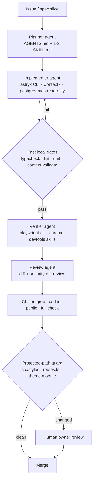

# 06 — AI tooling: MCP servers, skills, and the agent workflow

Checked **2026-11-28**. Every star count below comes from GitHub MCP (`search_repositories`, `--no-minimal-output`) on
that date; every "last commit" is the committer date of the default-branch HEAD (`list_commits`), not `pushed_at`.
Budget rule for this doc: **$0 upfront, no charge**; card available for free tiers. Anything that needs a paid plan is marked **later upgrade**
and paired with a free alternative. Unverified reasoning is marked **[INFERENCE]**.

## Verdict

| Decision | Primary | Fallback | Rejected |
| --- | --- | --- | --- |
| Agent interface | **CLI + skill** for any agent with a shell (`astryx`, `playwright-cli`, `chrome-devtools`) | MCP server for harnesses without a shell | Installing an MCP server where a CLI already exists |
| Design-system context | `astryx init --features agents` → `AGENTS.md` block + `astryx` CLI | `astryx mcp --docs-only` (web chat, no shell) | Figma MCP at $0 (20 calls/month) |
| Browser verification | **Playwright CLI + `--skills=agents`** | Playwright MCP (`--isolated`) | Browserbase, Browser Use |
| Live docs | installed `node_modules/next/dist/docs` + `astryx docs` | Context7 (1,000 calls/month free) | Scraping docs into the repo |
| DB introspection | **postgres-mcp `--access-mode=restricted`** | Neon MCP (vendor exception, 668★) | `modelcontextprotocol/servers` Postgres (archived) |
| Security scan | **Semgrep OSS in CI** + CodeQL on a public repo | CodeQL private = GitHub Code Security $30/committer/mo (**later**) | Semgrep MCP (archived 2025-10) |
| Review | review agent + `review` skill + CI gates | Copilot code review (**paid plans only**) | CodeRabbit on a private repo ($24/user/mo) |

**Thesis:** in 2026 the token-efficient surface moved from MCP to *CLI plus a skill that teaches the CLI*. Microsoft says
so explicitly in `microsoft/playwright-mcp`'s README ("Modern coding agents increasingly favor CLI-based workflows exposed
as SKILLs over MCP because CLI invocations are more token-efficient") and ships `microsoft/playwright-cli` for that reason.
An MCP server loads every tool schema into context on every turn; a skill loads ~100 lines once and then the agent runs one
narrow command. Use MCP for **stateful, credentialed, or no-shell** surfaces (GitHub, Postgres, Sentry, Cloudflare,
Firecrawl), and CLI+skill for everything the repo already contains.

This repo already follows that convention: `.agents/skills/` holds `nextjs-on-cloudflare`, `clone-website`,
`workers-best-practices`, `migrate-to-vinext`, and `CLAUDE.md` is a one-line `@AGENTS.md` import.

---

## 1. Verified MCP servers (2026-11-28)

Free column = usable at $0 without a card. "n/a" means the tool is a local process with no vendor account.

| Repo | ★ | Last commit | License | Free | What it uniquely enables | Install |
| --- | --- | --- | --- | --- | --- | --- |
| [meta/astryx](https://github.com/meta/astryx) | 33,586 | 2026-11-28 | MIT | yes | `astryx mcp`: every CLI command as a tool; `--docs-only` exposes only `search/build/component/hook/docs/template/discover/theme list`. CLI-first is the documented path | `npm i -D @astryxdesign/cli` → `npx @astryxdesign/cli mcp --docs-only` |
| [github/github-mcp-server](https://github.com/github/github-mcp-server) | 34,812 | 2026-11-27 | MIT | yes (Docker + PAT) | Issues, PRs, review threads, Actions logs, code search — closes the loop from agent to CI without a browser | remote `https://api.githubcopilot.com/mcp/`, or `docker run -i --rm -e GITHUB_PERSONAL_ACCESS_TOKEN ghcr.io/github/github-mcp-server` |
| [microsoft/playwright-mcp](https://github.com/microsoft/playwright-mcp) | 40,234 | 2026-11-18 | Apache-2.0 | yes | Persistent browser context, a11y tree, network mocking, trace export; right tool for exploratory/self-healing loops | `claude mcp add playwright -- npx @playwright/mcp@latest --isolated` |
| [ChromeDevTools/chrome-devtools-mcp](https://github.com/ChromeDevTools/chrome-devtools-mcp) | 59,671 | 2026-11-27 | Apache-2.0 | yes | Real DevTools: performance traces, LCP/CLS diagnosis, console+network, memory leaks. Ships 8 skills incl. `debug-optimize-lcp`, `a11y-debugging` | `npx chrome-devtools-mcp@latest --slim` |
| [upstash/context7](https://github.com/upstash/context7) | 65,567 | 2026-11-28 | MIT | 1,000 calls/mo | Version-pinned docs for Drizzle, Stripe, Workers, React 19 — the libraries whose docs are *not* already in `node_modules` | `npx ctx7 setup`, or URL `https://mcp.context7.com/mcp` + Bearer key |
| [cloudflare/mcp](https://github.com/cloudflare/mcp) | 1,201 | 2026-11-25 | Apache-2.0 | yes | Whole Cloudflare API in "code mode" (~1k tokens of schema), Workers deploys, tail logs, bindings | `https://mcp.cloudflare.com/mcp` (OAuth or API token) |
| [cloudflare/mcp-server-cloudflare](https://github.com/cloudflare/mcp-server-cloudflare) | 4,501 | 2026-10-22 | Apache-2.0 | yes | Product-specific servers; the docs server (`https://docs.mcp.cloudflare.com/mcp`) is the accurate one for Workers/vinext API questions | `https://docs.mcp.cloudflare.com/mcp` |
| [crystaldba/postgres-mcp](https://github.com/crystaldba/postgres-mcp) | 3,503 | 2026-11-28 | MIT | yes | Read-only schema inspection, `EXPLAIN`, index advisors, health checks against Neon — the only Postgres MCP still maintained above 1k★ | `uvx postgres-mcp --access-mode=restricted` |
| [supabase/mcp](https://github.com/supabase/mcp) | 3,026 | 2026-11-27 | Apache-2.0 | yes (Supabase Free) | Hosted remote; `read_only=true` + `features=database,docs`. Only relevant if the Supabase fallback is taken | `https://mcp.supabase.com/mcp?project_ref=…&read_only=true` |
| [getsentry/toolkit](https://github.com/getsentry/toolkit) | **976** (vendor exception) | 2026-11-28 | NOASSERTION | 5k errors/mo | Sentry issues, stack traces, releases, Seer analysis inside the agent; the `sentry-mcp` repo now redirects here (CLI + MCP in one) | `claude mcp add sentry -- sentry mcp`, or `https://mcp.sentry.dev` |
| [firecrawl/firecrawl-mcp-server](https://github.com/firecrawl/firecrawl-mcp-server) | 7,936 | 2026-11-27 | MIT | keyless 3 tools | Search/scrape/crawl with clean Markdown; keyless hosted endpoint needs no key and no card | `https://mcp.firecrawl.dev/v2/mcp` (no key), or `npx -y firecrawl-mcp` + `FIRECRAWL_API_KEY` |
| [GLips/Figma-Context-MCP](https://github.com/GLips/Figma-Context-MCP) | 16,331 | 2026-06-24 | MIT | yes (Figma token) | Figma layout → code without a paid Dev seat; the free substitute for Figma's official remote MCP | `npx -y figma-developer-mcp --figma-api-key=… --stdio` |
| [neondatabase/mcp-server-neon](https://github.com/neondatabase/mcp-server-neon) | **668** (vendor exception) | 2026-11-25 | MIT | yes (Neon Free) | Create/branch/reset Neon projects, run SQL, inspect slow queries. Now served **hosted**, not as a local binary | `https://mcp.neon.tech/mcp` + `Authorization: Bearer $NEON_API_KEY` (or `npx neon@latest init`) |
| [oraios/serena](https://github.com/oraios/serena) | 31,774 | 2026-11-27 | **GPL-3.0** | yes | LSP-level symbol retrieval/edit across TS/Rust/Go. Redundant with this harness's built-in `lsp` tool | install per the repo README (uvx/PyPI) — skipped here |
| [modelcontextprotocol/servers](https://github.com/modelcontextprotocol/servers) | 92,310 | 2026-11-27 | NOASSERTION | yes | Reference `filesystem`, `git`, `fetch`; the **Postgres server is archived** (2025) — do not use it | `npx -y @modelcontextprotocol/server-filesystem <dir>` (see §1.1 for why not) |

**Two vendor exceptions, both stated as such:** `getsentry/toolkit` (976★) is Sentry's own monorepo for its CLI + MCP;
`neondatabase/mcp-server-neon` (668★) is Neon's official server. Everything else clears 1,000★.

### 1.1 Rejected, with reasons

| Candidate | Evidence | Why not |
| --- | --- | --- |
| [semgrep/mcp](https://github.com/semgrep/mcp) | 688★, **archived**, last commit 2025-10-28 | Archived by Semgrep. Run `semgrep` as a CLI in CI instead — same engine, no stale wrapper |
| [browserbase/mcp-server-browserbase](https://github.com/browserbase/mcp-server-browserbase) | 3,397★, **archived**, last push 2026-07-20 | Archived; cloud browsers are a paid product with a card |
| [browser-use/browser-use](https://github.com/browser-use/browser-use) | 122,265★, MIT, active | Python runtime + a second model loop for what Playwright does deterministically; token cost per step is far higher. Its cloud is paid |
| `modelcontextprotocol/servers` → postgres | Marked **Archived** in the repo README | Superseded by postgres-mcp; no RLS awareness, no EXPLAIN tooling |
| `modelcontextprotocol/servers` → filesystem | Active | Grants broad read/write outside the repo. The agent already has `read`/`write`/`bash` scoped to the workspace — net negative |
| `modelcontextprotocol/servers` → git | Active | Redundant: every harness runs `git` through bash with better ergonomics |
| Figma official remote MCP (`https://mcp.figma.com/mcp`) | Starter plan = **20 tool calls/month**; real use needs a Dev/Full seat ($12–16/mo) | Useless at $0. **Later upgrade**; use GLips above until a designer seat exists |
| CodeRabbit | Free only for **public** repos; $24/user/mo otherwise | **Later upgrade.** Free substitute: review agent + Semgrep + the repo's own gates |
| Copilot code review | Docs: "Available for all paid Copilot plans"; "Copilot Free … does not include Copilot code review" | Not includable at $0 with certainty (Copilot Student is credit-metered and not documented as including it) |

---

## 2. Skills and instruction packs

| Repo | ★ | Last commit | License | Free | What it gives | Install |
| --- | --- | --- | --- | --- | --- | --- |
| [anthropics/skills](https://github.com/anthropics/skills) | 201,701 | 2026-11-16 | **no LICENSE file** | yes | `frontend-design`, `webapp-testing`, `skill-creator`, `mcp-builder`, `docx/xlsx/pdf` — the reference implementations of the format | `/plugin marketplace add anthropics/skills` then install a plugin |
| [obra/superpowers](https://github.com/obra/superpowers) | 328,642 | 2026-11-03 | MIT | yes | Methodology skills: `test-driven-development`, `systematic-debugging`, `requesting/receiving-code-review`, `verification-before-completion`, `writing-plans` | `/plugin install superpowers@claude-plugins-official` |
| [vercel-labs/agent-skills](https://github.com/vercel-labs/agent-skills) | 35,065 | 2026-11-20 | **no LICENSE file** | yes | `react-best-practices` (40+ React/Next perf rules), `composition-patterns`, `web-design-guidelines`, `react-view-transitions` | `npx skills add vercel-labs/agent-skills` |
| [microsoft/playwright-cli](https://github.com/microsoft/playwright-cli) | 15,512 | 2026-11-24 | Apache-2.0 | yes | CLI for browser actions **plus first-party skills** written for coding agents | `npm i -g @playwright/cli@latest && playwright-cli install --skills=agents` |
| [agentsmd/agents.md](https://github.com/agentsmd/agents.md) | 25,739 | 2026-09-10 | MIT | yes | The AGENTS.md format spec this repo's `AGENTS.md` already follows | n/a (spec) |
| [awesome-skills/code-review-skill](https://github.com/awesome-skills/code-review-skill) | 2,331 | 2026-09-08 | MIT | yes | A ready review checklist covering React 19 + TypeScript; useful as source material for the local `review` skill | copy rules, not the pack |
| [anthropics/claude-code-action](https://github.com/anthropics/claude-code-action) | 10,109 | 2026-11-25 | MIT | needs API key | Runs an agent on PRs in GitHub Actions — **costs model tokens**, not free | skip at $0 |

**License finding that changes usage:** `anthropics/skills` and `vercel-labs/agent-skills` have **no `LICENSE` file at the
repo root** (verified 2026-11-28). Absent a license, default copyright applies: installing them for local use through their
own installer is fine in practice, but **do not vendor, fork, or paste their text into this repo** without checking terms.
`obra/superpowers` (MIT) and `playwright-cli` (Apache-2.0) are safe to adapt with attribution.

**Discovery lists, not installs:** `ComposioHQ/awesome-claude-skills` (80,487★), `VoltAgent/awesome-agent-skills` (37,603★),
`sickn33/agentic-awesome-skills` (50,470★). Use them to find one skill, never to bulk-install — 3,000 skills cost more
context than the codebase and none of them know Astryx or this repo's schema.

---

## 3. Repo-local skills to author (9)

Off-the-shelf coverage is thin exactly where this project is specific: Next 16 caching semantics, Astryx's template-first
workflow, Drizzle migration discipline, `org_id` tenancy, Stripe idempotency, and the frozen Tano CSS. Write these locally;
they are cheap, reviewable, and versioned with the code.

**Location:** `.agents/skills/<name>/SKILL.md` (canonical — this repo already uses it, and `playwright-cli install
--skills=agents` writes there). For Claude Code add `.claude/skills -> ../.agents/skills`; Claude also reads `AGENTS.md`
through the existing `CLAUDE.md` import. Keep each skill under ~150 lines with a `references/` folder for long material,
and make `description` name both the trigger and the file globs.

| Skill | Scope (one line) | Loads when |
| --- | --- | --- |
| `next16-app-router` | Marketing-only: route/segment/`caching` semantics for Next 16.4; read `node_modules/next/dist/docs` before writing; no Pages-Router APIs, no `unstable_` without a doc quote | editing `src/app/**`, `route.ts`, `middleware.ts` in marketing |
| `astryx-ui` | Template-first UI: `astryx build "<idea>"` → `astryx template` → `astryx component <Name>`; never raw `
` layouts, never `style={{}}`, tokens only | any dashboard UI file |
| `drizzle-postgres` | Schema conventions (snake_case columns, `org_id` FK first, `timestamptz`), migration naming, expand→migrate→contract, no destructive migration without an approved plan | `db/schema/**`, `drizzle/**` |
| `multi-tenant-authz` | Deny-by-default: every query filtered by `org_id` from the session, never from the request body; cross-tenant tests required for each new table | auth, queries, oRPC procedures |
| `paddle-webhooks` | Verify `Paddle-Signature` over `{ts}:{raw body}` (5-min tolerance) before parsing; claim `processed_events` `received→processing→done` with a lease, use provider state (not deltas), replay-safe | `apps/api/**/webhooks/**` |
| `playwright-verify` | Acceptance checks in a real browser: start the app, drive the flow, capture a screenshot + console errors as evidence; no "looks right" claims | before claiming UI work done |
| `design-tokens` | Frozen surfaces: never edit `src/styles/**` (Tano CSS) or generated Astryx theme modules; use Astryx `--color-*`/`--radius-*`/`--duration-*` tokens; add tokens via `defineTheme`, not literals | any style change |
| `content-schema-guard` | The marketing site's Zod page schema and `src/content/routes.ts` manifest are generated: edit JSON + rerun `npm run content:check`, never hand-edit the manifest | `src/content/**` |
| `security-diff-review` | Diff-scoped OWASP pass: authz on every new route, injection, SSRF, secret handling, unsafe HTML, dependency additions | review agent, pre-merge |

Authored locally, these cost nothing and survive tool churn. Treat `obra/superpowers` as the generic methodology layer
below them; do not duplicate its TDD/debugging content.

---

## 4. Conditional branch: Rust or Go instead of TypeScript

Coverage is **materially weaker** on both. The gap is not "no MCP servers exist" — it is that no maintained, ≥1k★ MCP
server knows Axum/sqlx or Chi/sqlc, and the model's training density for those frameworks is lower, so the agent needs
more correction per file.

| Branch | Verified tooling | Gap | Verdict |
| --- | --- | --- | --- |
| **TypeScript** (Next 16, Drizzle 36,431★) | Astryx CLI+MCP, postgres-mcp, Context7, Playwright CLI/MCP, chrome-devtools, GitHub, Sentry, Cloudflare, Semgrep | none blocking | **Primary** |
| **Go** (Chi 23,192★, sqlc 18,517★) | `mark3labs/mcp-go` 9,255★ is an SDK for *building* servers, not a stack tool; `golangci-lint` 19,556★ (GPL-3.0) and `go vet` are excellent CLI gates; Playwright/CDP and postgres-mcp still apply; Serena (GPL) gives gopls symbols | No sqlc/Chi-aware MCP; no Context7-depth equivalent for `sqlc` codegen patterns | Acceptable for **one** service behind a TS BFF |
| **Rust** (Axum 28,020★) | `modelcontextprotocol/rust-sdk` 4,157★ (server SDK); `rust-lang/rust-analyzer` 17,021★ gives real LSP feedback if the harness exposes it; `cargo clippy`/`nextest` gates are strong | The only rust-analyzer MCP is `zeenix/rust-analyzer-mcp` at **91★** — below bar, unmaintained-adjacent; no sqlx MCP; 30–120 s compile cycles make agent loops slow | **Last resort**, compute-bound services only |

Decision rule: pick the language the *agent* can verify fastest. TS wins on tool coverage and iteration latency; Go is
tolerable for a single narrow service; Rust is a deliberate cost, justified only by a measured CPU/memory need (the
Workers Free 10 ms CPU cap is a real reason to consider it later, not now).

---

## 5. Agent workflow and gates

| Gate | Command | Blocks |
| --- | --- | --- |
| Types | `npm run typecheck` | any PR |
| Lint/format | `npm run lint`, `npm run format:check` | any PR |
| Unit | `npm test` | any PR |
| Content contract | `npm run content:validate`, `npm run content:check` | marketing content PRs |
| Full build | `npm run check` | pre-merge only (it builds; too slow per edit) |
| Browser | `npx playwright test` (or `playwright-cli` during dev) | UI PRs |
| SAST | `semgrep scan --config p/typescript --config p/react --error` | any PR |
| Deep SAST | CodeQL default setup | **public repo only** (private = $30/committer/mo) |
| Protected paths | `git diff --name-only origin/main...HEAD \| grep -E '^(src/styles/\|src/content/routes\.ts\|.*theme.*\.css$)'` → fail | any PR |

**Keeping agents out of generated files.** Three layers, because a prompt is not a control:

1. `CODEOWNERS` on `src/styles/`, `src/content/routes.ts`, `public/sites/`, and generated Astryx theme modules, plus
   branch protection "Require review from Code Owners". A prompt injection or a tired agent cannot merge past it.
2. A CI job that fails when those paths change in a PR without an `allow-protected` label (snippet above).
3. A `Protected paths` section in `AGENTS.md` and the `design-tokens` / `content-schema-guard` skills, so the agent rarely
   tries. Regeneration must go through `astryx theme add …` or `npm run content:check`, never a hand edit.

Add the same rule for tests: the review agent's checklist must reject deletions or loosened assertions in `*.test.ts`
unless the spec changed in the same diff. That is a review rule, not a lint rule — automating it produces false confidence.

**Context budget (measured [INFERENCE], not benchmarked here):** a 30-tool MCP server costs roughly 4–8k tokens of schema
per turn; a skill costs ~1–2k once. Practical limits: at most **4 MCP servers per agent session** (this repo: GitHub,
postgres, Astryx-docs or Context7, browser tooling), `chrome-devtools-mcp --slim` for routine work, Playwright MCP only
when persistent state matters, and Context7 with a narrow topic + explicit token cap per call. Prefer `astryx component
Button` (≈1k) over any doc server for Astryx, and `node_modules/next/dist/docs` over Context7 for Next — it is the exact
installed version, offline and free.

**Commit the config.** One canonical `.mcp.json` at the repo root with `${VAR}` placeholders (never keys), a read-only
`GITHUB_PERSONAL_ACCESS_TOKEN`, and `--access-mode=restricted` for Postgres; mirror it to `.vscode/mcp.json` for Copilot.
Review MCP config changes like code, because they are.

---

## 6. Install now (max 12)

| # | Tool | Command | Why now |
| --- | --- | --- | --- |
| 1 | Astryx agent docs | `npm i -D @astryxdesign/cli && npx @astryxdesign/cli init --features agents` | Writes the versioned Astryx block into `AGENTS.md`; `astryx` is also the MCP server if ever needed |
| 2 | Astryx npm alias | add `"astryx": "node node_modules/@astryxdesign/cli/clients/cli/bin/astryx.mjs"` to `scripts` | Stops agents guessing binary paths (documented failure mode) |
| 3 | Playwright CLI + skills | `npm i -g @playwright/cli@latest && playwright-cli install --skills=agents` | Browser verification without tool-schema overhead |
| 4 | Playwright MCP (secondary) | `claude mcp add playwright -- npx @playwright/mcp@latest --isolated` | Only for long exploratory sessions |
| 5 | Chrome DevTools MCP | `npx chrome-devtools-mcp@latest --slim --no-usage-statistics` | Perf/a11y debugging with first-party skills |
| 6 | Context7 | `npx ctx7 setup` | Drizzle/Stripe/Workers docs, 1,000 calls/mo free |
| 7 | GitHub MCP | `docker run -i --rm -e GITHUB_PERSONAL_ACCESS_TOKEN ghcr.io/github/github-mcp-server` | PR/CI loop; PAT scoped read-only |
| 8 | Postgres MCP Pro | `uvx postgres-mcp --access-mode=restricted` | Read-only schema + EXPLAIN against Neon |
| 9 | Sentry toolkit | `claude mcp add sentry -- sentry mcp` | After first deploy; free Developer tier (5k errors/mo) |
| 10 | Cloudflare MCP | `https://mcp.cloudflare.com/mcp` (+ docs server) | Deploy/tail/bindings without dashboard clicking |
| 11 | Firecrawl (keyless) | `https://mcp.firecrawl.dev/v2/mcp` | Research with zero keys and zero card |
| 12 | Superpowers (MIT) | `/plugin install superpowers@claude-plugins-official` | TDD, debugging, review discipline — the parts agents skip |

**Do not install:** `semgrep/mcp` (archived), `browserbase/mcp-server-browserbase` (archived, paid), Browser Use (duplicate
of Playwright, Python + second model loop), `@modelcontextprotocol/server-postgres` (archived), `server-filesystem` /
`server-git` (redundant and over-privileged), Figma MCP at $0 (20 calls/mo), Neon MCP unless Neon branching is actually
used (668★, extra moving part), Astryx MCP for shell-capable agents (CLI is cheaper), 3,000-skill mega-packs, and the
unscoped `npx astryx` (resolves to an unrelated npm package — always use `@astryxdesign/cli`).

---

## 7. Risks and what would change this

| Risk | Impact | Mitigation |
| --- | --- | --- |
| Astryx is **0.7.x beta** (0.7.17 on npm, MIT) | Breaking changes between minors; generated theme module drifts | Pin exact versions, upgrade via `npx @astryxdesign/cli upgrade --from <old> --apply`, rerun `init --features agents` |
| Context7 free quota (1,000 calls/mo) | Hits zero mid-sprint | Prefer local docs; cache answers in the skill's `references/` |
| MCP servers are unaudited code with repo access | Prompt injection → exfiltration, especially Firecrawl/GitHub content | Read-only tokens, `--access-mode=restricted`, no secrets in `.mcp.json`, review server upgrades |
| Copilot Student is credit-metered, auto-model only, excludes third-party agents | Agent capacity can throttle | Keep CI gates authoritative; the workflow must pass with any model |
| No license on `anthropics/skills`, `vercel-labs/agent-skills` | Legal ambiguity if vendored | Use their installers, do not copy text into the repo |
| Semgrep free ruleset is partial (242 of 316 `p/typescript` rules are Pro) | False negatives | Add CodeQL on a public repo; keep the review skill for authz/logic bugs SAST cannot see |

**What would change the decision:** Astryx leaving beta with a stable theme API (drop the pin, prefer `astryx mcp` over ad-hoc CLI calls); a maintained
≥1k★ sqlx or sqlc MCP (makes Go/Rust viable); Context7 raising the free quota or the repo adopting a docs mirror (drop
Context7); GitHub including code review in Copilot Student (add it as a required reviewer, keep Semgrep); a paid plan
appearing in the budget (Figma Dev seat first, then CodeRabbit, then Sentry Team).
